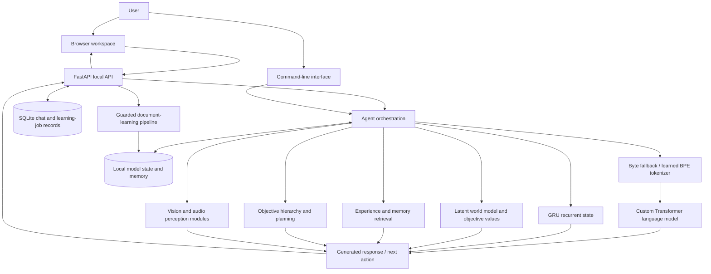
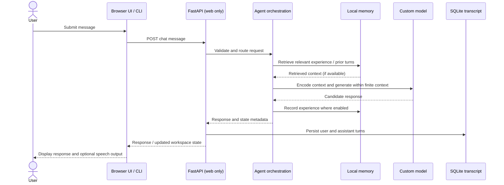
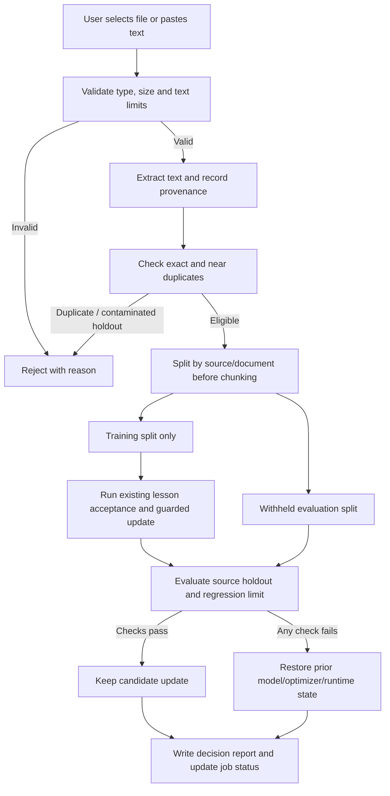
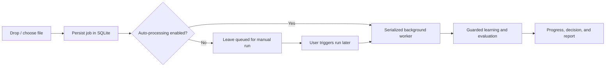
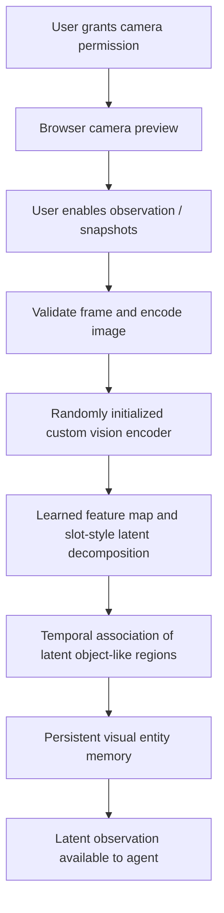
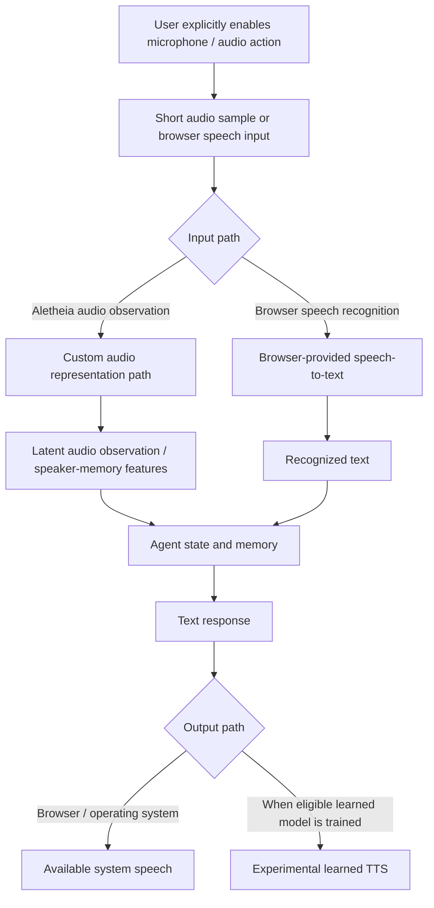
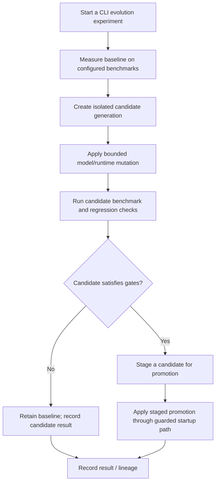

# Aletheia — From-Scratch Multimodal AI Research Platform

**Current release:** FINAL34 · `0.34.0`\
**Stack:** Python · PyTorch · FastAPI · SQLite · NumPy · JavaScript · HTML5 · CSS3\
**Research areas:** custom language modeling · continual learning · self-supervised perception · memory · planning · experimental model evolution

Aletheia is a local-first AI research prototype built around a **custom neural model initialized from random weights**. It combines a Transformer-based language model with recurrent state, persistent memory, experimental world-model/planning components, visual and audio representation learning, and a local browser interface. It is designed for controlled experiments in learning from data supplied by the user—not as a finished, general-purpose assistant.

> **Important expectation:** a fresh clone does not include a trained model or learned memory. Since the core model starts from random initialization, useful behavior depends on training, available compute, and evaluation. Implemented code paths are not, by themselves, proof of reliable real-world capability.

---

## Contents

- [What Aletheia is](#what-aletheia-is)
- [Current capabilities](#current-capabilities)
- [System architecture](#system-architecture)
- [How a conversation works](#how-a-conversation-works)
- [How guarded learning works](#how-guarded-learning-works)
- [Camera and vision workflow](#camera-and-vision-workflow)
- [Audio and voice workflow](#audio-and-voice-workflow)
- [Experimental self-evolution](#experimental-self-evolution)
- [Run Aletheia locally](#run-aletheia-locally)
- [Use the web workspace](#use-the-web-workspace)
- [Teach Aletheia from files or text](#teach-aletheia-from-files-or-text)
- [Other CLI experiments](#other-cli-experiments)
- [Tests and verification](#tests-and-verification)
- [Project layout](#project-layout)
- [Privacy, security, and limitations](#privacy-security-and-limitations)

## What Aletheia is

Aletheia is an experiment in building a learnable agent architecture without bundling a pretrained language model or depending on a hosted LLM API for its core text model. It includes:

- A custom autoregressive Transformer language model implemented in PyTorch.
- A byte-fallback tokenizer and an optional BPE tokenizer trained on a corpus provided by the user.
- A GRU-based recurrent state and learned latent representations for text, vision, and audio observations.
- Persistent experience/memory components and cross-conversation retrieval.
- A source-separated document-learning pipeline with held-out evaluation and rollback safeguards.
- Experimental visual entity discovery/tracking, audio representation learning, speech bridges, planning, and model-evolution tooling.
- A responsive FastAPI web application that connects the research engine to a local browser interface.

The project does **not** claim consciousness, sentience, human-like understanding, or general intelligence. Its goal is to make learning, interaction, memory, evaluation, and experimental iteration inspectable and testable.

## Current capabilities

The table separates features available in the current code from experiments whose quality depends on training and evaluation.

| Area | Available in FINAL34 | Status and boundaries |
|---|---|---|
| Language model | Custom PyTorch Transformer with tied token/output embeddings and finite context | Randomly initialized unless a local checkpoint has been trained; reply quality is not guaranteed |
| Tokenization | Exact UTF-8 byte fallback; optional learned byte-fallback BPE | BPE merges are learned from user-supplied text; tokenizer training must not use held-out evaluation sources |
| Recurrent cognition / world model | GRU-based state, latent multimodal representations, predictive and objective-value components | Research components; their presence does not establish robust reasoning or agency |
| Memory | Persistent experience and visual-entity memory; conversation transcripts stored separately in SQLite; cross-chat retrieval | Retrieval can miss or misinterpret past information; data remains local to the instance |
| Document learning | TXT, Markdown, PDF, DOCX, EPUB, HTML/XHTML, and optional Parquet ingestion | Scanned/image-only PDFs need OCR beforehand; OCR is not bundled |
| Learning safeguards | Provenance, duplicate checks, source-level train/holdout split, existing lesson acceptance check, held-out regression gate, rollback, job reports | Safeguards reduce specific forms of regression and leakage but cannot guarantee correctness or prevent all failure modes |
| Web workspace | Multiple chats, feedback, conversation export, drag/drop learning, job monitoring, memory search, preferences, responsive UI and theme switch | Local, single-user prototype; not intended for public Internet deployment |
| Camera / vision | Opt-in camera preview and snapshots; custom visual encoder, slot-style latent object discovery, temporal tracking and entity memory | Does not provide reliable natural-language scene captioning or general object naming |
| Audio / voice | Opt-in short audio observation; audio representation and speaker-memory code; browser speech APIs; optional learned speech modules | Browser speech recognition may use a browser-vendor service; trained speech/TTS quality is not guaranteed; enrollment is not voice cloning |
| Planning | Objective hierarchy, candidate sub-objectives, outcome/verifier and latent-rollout research components | Planning quality and task success must be measured for each environment |
| Self-evolution | CLI experiments for runtime parameters, candidate generations/benchmarks, and a restricted source-change workflow | Experimental; robust scientific self-evolution is not a completed capability. Source changes have validation/approval safeguards |
| Verification | Unit/regression tests, syntax checks, bounded test-batch runner, capability report | Automated tests validate tested software behavior, not general intelligence |

## System architecture

The local web application is a presentation and orchestration layer over the research engine. It does not replace or magically improve the model itself.



### Main subsystems

- **`aletheia/model.py`** — custom Transformer and recurrent/latent model components.
- **`aletheia/tokenizer.py`** — byte fallback and learned byte-fallback BPE tokenizers.
- **`aletheia/agent.py`** — agent orchestration across language, memory, learning, perception, and objectives.
- **`aletheia/memory.py`** — persistent experience and memory utilities.
- **`aletheia/learning_pipeline.py`** — document extraction, provenance, data splits, guarded training, evaluation, and reports.
- **`aletheia/perception.py`, `speech.py`, `tts.py`, `voice.py`** — visual/audio representations, speech experiments, synthesis, and speaker-memory paths.
- **`aletheia/planner.py`, `objectives.py`, `objective_value.py`, `outcomes.py`** — objective hierarchy, planning, predicted values, and outcome signals.
- **`aletheia/evolution.py`** — experimental runtime/model-generation and restricted source-change experiments.
- **`aletheia/webapp.py` and `aletheia/web/`** — FastAPI API and browser assets.

## How a conversation works



The CLI uses the agent without the FastAPI/browser hop. Each model call has a finite context window (1536 tokens by default in the current configuration); the long-term transcript is stored separately, and retrieval selects context rather than placing every past message into the model at once.

## How guarded learning works

Aletheia's learning studio can queue a supported document or text for learning. The uploaded file is treated as data and is **not executed as code**.



### Learning safeguards

1. **Input validation and limits** are applied before extraction/training.
2. **Provenance** records user-supplied source, title, and license metadata. This is a record, not an automatic legal/license check.
3. **Source-level splitting happens before chunking.** The held-out split must not be used for model training, replay, or tokenizer fitting within this pipeline.
4. **Duplicate and contamination checks** can reject material that overlaps heavily with accepted lesson memory.
5. **Two acceptance layers** are used: Aletheia's existing lesson acceptance gate and a source-holdout regression gate.
6. The default maximum permitted source-holdout regression is **0.08 bits per byte**. This is a configured threshold, not a universal proof of quality.
7. Rejected updates restore prior model/optimizer/runtime state and produce a report with metrics and the decision reason.
8. Jobs are queued in SQLite. The worker serializes model operations; queued jobs and status can persist across process restarts.

**Supported file types:** `.txt`, `.md`, `.markdown`, `.pdf`, `.docx`, `.epub`, `.html`, `.htm`, `.xhtml`, and `.parquet` (requires the optional `pyarrow` dependency). The documented defaults cap uploads at 50 MiB, extracted text at 5 million characters, training text at 250,000 characters per job, and held-out text at 100,000 characters per job. These limits can be configured through CLI options where supported. OCR is not included.

### Learning workflow from the UI



The auto-processing preference controls whether queued jobs start automatically; it does not bypass the acceptance checks. A manual legacy training command outside the guarded job pipeline may not have the same job-level holdout protections, so use the commands below for normal document learning.

## Camera and vision workflow



The vision encoder and slot-style object-discovery module are implemented in the project and can learn from self-supervised experience. Spatial features and track/entity identifiers can be retained between observations. This is **latent perception**, not a semantic object detector: FINAL34 does not claim reliable labels such as “this is a dog,” broad scene descriptions, or general-purpose visual captioning.

In the web interface, camera access is opt-in and depends on browser permissions. The app sends periodic observations when the user enables the feature. Raw media is temporary in the request path, but derived latent observations or memory entries may persist according to the memory implementation.

## Audio and voice workflow



- The audio observation path accepts short samples and encodes them through Aletheia's audio/perception components.
- Browser speech recognition is a convenience integration. Depending on the browser, it may use a vendor service and may not be local or private to the device.
- Host/browser text-to-speech can be used without a trained Aletheia speech model.
- From-scratch speech recognition and learned TTS require suitable training data and evaluation before their output should be trusted.
- Voice-sample enrollment requires consent. Enrollment stores a speaker sample/profile; it **does not** automatically clone a voice.

## Experimental self-evolution

Aletheia includes an `EvolutionLab` and a generational-evolution path that can experiment with runtime parameters, create isolated candidate generations, mutate selected checkpoint parameters, and benchmark candidates. A separate restricted source-change workflow can propose a rewrite in an allow-listed area, validate it, and stage it for explicit approval.



This is an **experimental optimization and validation framework**, not a claim that Aletheia autonomously rewrites and improves all of its own code or reliably becomes more intelligent. Results depend on benchmark quality, seeds, resource limits, the current model state, and safeguards. Use the evaluation-only mode first:

```powershell
python -m aletheia --evolve-generation --evolution-population 4 --evolution-no-promote --device auto
```

Check the available options and current state before running other evolution operations:

```powershell
python -m aletheia --help
python -m aletheia --evolution-status
```

Source-rewrite experiments should remain limited to the allow-listed, validation/approval-controlled workflow. Do not use experimental evolution on a repository you cannot restore from backup.

## Run Aletheia locally

### Requirements

- **Python 3.12 or newer** (Python 3.12 is a sensible baseline for reproducibility).
- Git and a terminal (examples below use Windows PowerShell).
- Enough disk space for dependencies, training inputs, local checkpoints, logs, and memory databases.
- A CPU works for basic use; a compatible CUDA/PyTorch setup can accelerate training. Device support depends on the installed PyTorch build and driver.
- Camera and microphone are optional and require user/browser/OS permission.

### 1. Clone the repository

```powershell
git clone https://github.com/Mukul-1222/Aletheia-AI.git
cd Aletheia-AI
```

### 2. Create and activate a virtual environment

```powershell
py -3.12 -m venv .venv
.\.venv\Scripts\Activate.ps1
python -m pip install --upgrade pip
```

If PowerShell blocks activation in this terminal, use an appropriate process-scoped execution policy or activate the environment using your preferred shell. Avoid changing system-wide policy just for this project.

### 3. Install the app and test dependencies

```powershell
python -m pip install -e ".[webapp,test]"
```

This installs the package in editable mode plus its web and test extras. Optional integrations can be installed only when needed:

```powershell
# Local camera/audio device helpers
python -m pip install -e ".[vision,audio]"

# Parquet document ingestion
python -m pip install -e ".[parquet]"

# Optional browser automation experiments (not enabled by default)
python -m pip install -e ".[browser]"
python -m playwright install chromium
```

Aletheia's neural weights and personal memory are not bundled with the repository. The first run creates/uses local runtime state under the configured project root. The `.gitignore` excludes the `data/` directory, checkpoints, databases, caches, and other generated/private state intentionally.

## Use the web workspace

Start the local web app from the repository root:

```powershell
python -m aletheia.webapp --root .
```

Open **http://127.0.0.1:8765** in a modern browser.

The server binds to loopback; remote/LAN binding is deliberately unsupported. The neural engine is loaded lazily when an operation needs it, so serving the UI and checking basic status do not necessarily initialize the model.

### Web workspace features

- **Chat:** create multiple persistent conversations, send messages, provide per-turn feedback, export a conversation or all conversations as JSON, and optionally use available speech output.
- **Interactive orb:** state-reactive UI for activities such as listening, thinking, speaking, learning, and visual observation. It reflects application state, not neural activity or consciousness.
- **Learning studio:** drag/drop or select supported documents, paste text, queue jobs, inspect progress, run or retry eligible jobs, and retrieve reports.
- **Vision and voice:** explicit camera preview/snapshot controls, short audio-observation path, browser speech recognition/synthesis where available, and consent-gated speaker-sample enrollment.
- **Memory explorer:** search indexed memories and retrieve relevant prior conversational experience.
- **Preferences:** light/dark themes, response budget and UI options such as auto-scroll.
- **Responsive layout:** desktop and mobile navigation, reduced-motion support, local packaged HTML/CSS/JavaScript assets.

No camera or microphone is silently activated. Browser speech recognition may still use a browser-vendor service; check the browser's behavior and privacy settings if local-only audio processing is required.

## Teach Aletheia from files or text

Prefer the **guarded learning pipeline** for normal learning tasks. Run commands from the repository root so configuration and runtime paths resolve consistently.

### Teach a file end-to-end

```powershell
python -m aletheia --root . --learning-teach-file "C:\path\to\lesson.pdf" --learning-license "CC BY 4.0" --device auto
```

Replace the path and license with the actual source and its permitted use. The license flag records metadata; it does not determine whether you legally may use a source.

### Queue a file without immediately training

```powershell
python -m aletheia --root . --learning-add "C:\path\to\lesson.pdf" --learning-license "CC BY 4.0"
python -m aletheia --root . --learning-jobs
```

### Inspect or process queued jobs

```powershell
# Process queued jobs serially
python -m aletheia --root . --learning-process-queue --learning-max-jobs 25 --device auto

# Inspect a specific job using the ID shown in the job list
python -m aletheia --root . --learning-job-status JOB_ID

# Retry an eligible rejected/failed job with a durable split
python -m aletheia --root . --learning-retry-job JOB_ID
```

### Teach literal text

```powershell
python -m aletheia --root . --learning-teach-text "Your lesson text goes here." --learning-title "Introductory lesson" --device auto
```

For long text, save it to a UTF-8 `.txt` file and use `--learning-teach-file` rather than placing a large passage in the command line.

### Queue text for later

```powershell
python -m aletheia --root . --learning-add-text "A sufficiently long lesson passage." --learning-title "Queued lesson"
```

### Check learning state

```powershell
python -m aletheia --status
python -m aletheia --lessons
```

The exact options available in the installed version are shown by `python -m aletheia --help`.

### What learning does and does not mean

A training job changes model parameters only if its acceptance and holdout checks pass. Lower training loss does not mean the model has understood the subject or will answer questions correctly. Evaluate it with questions and source-separated material that were not used to train it. Do not place private or unlicensed material into lessons unless you are authorized to do so.

## Other CLI experiments

Aletheia exposes additional research paths through the command line. These are experimental and may require local training data, optional packages, or a working device backend.

### Interactive chat and a single message

```powershell
python -m aletheia --chat
python -m aletheia --message "Hello, Aletheia."
```

Early generations may be marked experimental and can be incoherent before the model is sufficiently trained. Use `/help` in the interactive CLI to see its chat commands.

### Train a byte-fallback BPE tokenizer

```powershell
python -m aletheia --tokenizer-train "C:\path\to\corpus" --tokenizer-vocab-size 2048
```

Use training corpus data only—never a held-out evaluation corpus. The byte-fallback design preserves a path for every UTF-8 byte, including text outside the learned merges.

### Vision / image experiments

```powershell
# Observe an image through Aletheia's visual encoder
python -m aletheia --see "C:\path\to\image.png"

# Attempt recognition against visual entities learned previously
python -m aletheia --recognize "C:\path\to\image.png"
```

For local camera capture from the CLI, install the optional vision dependency and inspect the flags first:

```powershell
python -m pip install -e ".[vision]"
python -m aletheia --help
```

### Audio / speech experiments

The CLI includes options for encoding WAV files, speaker enrollment/recognition, training a speech-to-byte bridge from a WAV/transcript manifest, and training/synthesizing with experimental TTS. These paths need correctly formatted training data and should be reviewed via `python -m aletheia --help` before use. Do not assume these models are trained or production quality in a fresh clone.

### Capability report

Generate a local capability/dependency inventory:

```powershell
python -m aletheia.capability_report --root . --output data/capability_report.json
```

Dependency presence is not an end-to-end capability test; inspect the report alongside actual evaluation results.

## Tests and verification

Run checks locally from the repository root:

```powershell
python -m compileall -q aletheia tests tools
python -m pytest -q
```

If a single long PyTorch test process hangs or exhausts resources, the repository includes a bounded-batch runner:

```powershell
python tools/run_test_batches.py --release FINAL34 --batch-size 20 --test-timeout 180 --report FINAL34_BATCH_TEST_RESULTS.json --log-dir test-results/final34-batches
```

The FINAL34 release verification record reports **375 passed, 1 skipped, 0 failed, and 0 timed out** across 376 test nodes in the documented environment. A GPU-specific test was skipped in that environment because CUDA was unavailable. Results will vary with the Python, PyTorch, hardware, optional packages, and operating system used to run the project. Passing tests validate the covered software contracts, not intelligence, perception quality, or general task competence.

Related release records:

- [`FINAL34_AUDIT.md`](FINAL34_AUDIT.md) — implementation details, verified behavior, and limitations.
- [`FINAL34_TEST_RESULTS.json`](FINAL34_TEST_RESULTS.json) — structured release-wide test summary.
- [`FINAL34_BATCH_TEST_RESULTS.json`](FINAL34_BATCH_TEST_RESULTS.json) — batch-level verification details.
- [`FINAL34_FILE_INVENTORY.md`](FINAL34_FILE_INVENTORY.md) — release source-file inventory.

## Project layout

```text
Aletheia-AI/
├── aletheia/
│   ├── model.py                 # Custom Transformer and recurrent model components
│   ├── agent.py                 # Agent orchestration and CLI integration
│   ├── tokenizer.py             # Byte fallback and learned BPE
│   ├── memory.py                # Persistent memory / experience
│   ├── learning_pipeline.py     # Guarded document ingestion and training
│   ├── perception.py            # Vision/audio latent perception and tracking
│   ├── speech.py                # Experimental speech recognition bridge
│   ├── tts.py                   # Experimental learned text-to-speech
│   ├── evolution.py             # Experimental candidate evolution and source changes
│   ├── planner.py               # Objective hierarchy / planning
│   ├── webapp.py                # FastAPI local web application
│   └── web/                     # HTML, CSS, JavaScript, favicon
├── tests/                       # Unit and regression tests
├── tools/                       # Test and verification tools
├── evaluation/                  # Evaluation guidance / utilities
├── config.json                  # Model and runtime configuration
├── pyproject.toml               # Package metadata and optional dependencies
├── requirements.txt             # Common runtime dependencies
├── DATASETS.md                  # Dataset notes
├── RESEARCH_NOTES.md            # Research notes
└── README.md
```

Local runtime files are created under `data/` and intentionally are not part of the source repository. Depending on usage, these can include trained checkpoints, tokenizer state, memory, learning-job databases, chat transcripts, and evaluation artifacts.

## Privacy, security, and limitations

### Local-first behavior

- The web server binds to `127.0.0.1` by default and rejects unsupported remote binds. Do not expose it directly to a LAN or the public Internet.
- This is a single-user research prototype, not a hardened multi-user service. It does not provide deployment-grade account authentication, per-user authorization, or a full security review.
- The frontend ships with the repository; it does not require an analytics service, ad network, external font, or third-party UI asset to render.
- Camera and microphone use requires explicit user action and device permissions.

### Data handling

- Raw camera/audio inputs are temporary in the app's request path, but derived latent observations, experience memory, speaker profiles, model checkpoints, and transcripts may persist locally.
- Treat the `data/` directory and exported conversation JSON as private. Review them before sharing logs or backups.
- `.gitignore` intentionally excludes runtime data, checkpoints, local databases, environment files, and caches. Do not commit trained state or private training corpora by accident.
- Do not commit API keys, access tokens, personal data, private datasets, or learned speaker samples.

### Known limitations

- The core language model is trained from scratch and can produce poor or incoherent answers, especially before sufficient learning.
- A finite model context and imperfect retrieval mean that persistent history is not the same as perfect recall.
- Vision currently produces learned latent features, slot-style decompositions, tracking, and entity-memory signals; broad reliable scene captioning and general object naming are not complete.
- Browser speech recognition may depend on a vendor service. Reliable from-scratch transcription and high-quality learned TTS require additional training and evaluation.
- Voice enrollment alone does not clone a voice. Image generation, general-purpose visual captioning, a finished agent-to-agent interface, and production-grade autonomous self-evolution are not complete capabilities.
- No pre-trained language model or hosted LLM API is bundled for the core model. System/browser speech services are separate integrations and should not be confused with learned Aletheia capabilities.
- `config.json` and the CLI expose powerful research settings; understand a command before running long training or evolution jobs.

### License

No `LICENSE` file is included in this repository at present. Until a license is added, do not assume that public visibility grants permission to reuse, redistribute, or commercially use the code.

---

**Project goal:** explore how learning, memory, perception, prediction, planning, and evaluation can be engineered in one inspectable system—and report its limitations as carefully as its capabilities.
